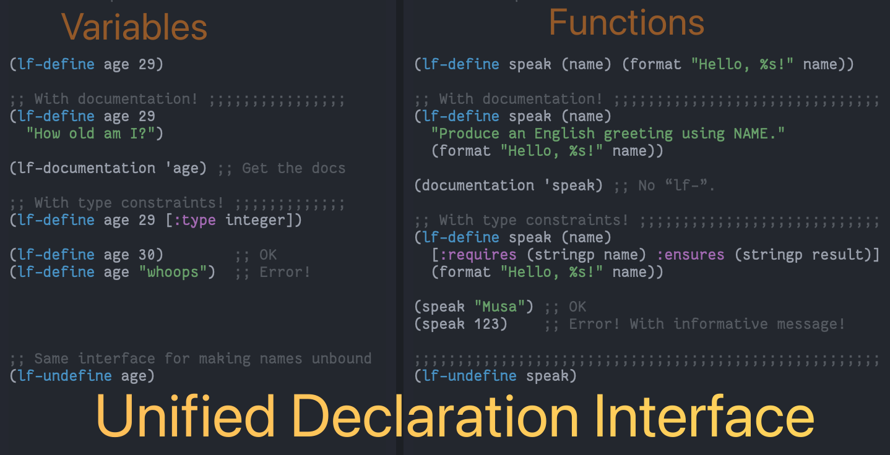

#+title: lf.el ---Language Features for Emacs Lisp
#+author: Musa Al-hassy
#+options: toc:nil num:nil

[[https://github.com/alhassy/lf.el][https://img.shields.io/badge/lf-1.0-informational?logo=Gnu-Emacs]]
[[https://github.com/alhassy/lf.el/issues][https://img.shields.io/badge/contributions-welcome-green?logo=nil]]
[[https://alhassy.github.io/][https://img.shields.io/badge/author-musa_al--hassy-purple?logo=nintendo-3ds]]
[[https://www.buymeacoffee.com/alhassy][https://img.shields.io/badge/-buy_me_a%C2%A0coffee-gray?logo=buy-me-a-coffee]]
[[https://alhassy.github.io/lf.el][https://img.shields.io/badge/beautiful-HTML_webpage-success?logo=Org-mode]]

* Summary

| "L"anguage "F"eature                               | Implementation                  |
|----------------------------------------------------+---------------------------------|
| Singular interface for variable & function defs    | ~lf-define~                     |
| Interface for /typed/ variables & functions        | ~lf-define~                     |
| Singular interface for unbinding names             | ~lf-undefine~                   |
| Documentation retrieval & assignment               | ~lf-documentation~              |
| Helper for ~&optional~ and ~&rest~ arguments       | ~lf-extract-optionals-from-rest~ |
| Call-site type checking for existing functions     | ~lf-declare-type~               |
| Pre/post-condition contracts for existing functions | ~lf-specify~                   |

* Example: ~lf-define~ with contracts

Define a function and place constraints on its inputs and output:

#+begin_src emacs-lisp
(lf-define speak (name age)
    [:requires (and (stringp name) (integerp age))
     :ensures  (stringp result)]
    "Greet person NAME with their AGE."
    (format "Hello %s year-old %s!" age name))
;; => speak
#+end_src

Type-satisfied inputs yield an output:

#+begin_src emacs-lisp
(speak "musa" 29)
;; => "Hello 29 year-old musa!"
#+end_src

Type-invalid inputs yield a friendly error:

#+begin_src emacs-lisp
(speak 'musa 29)  ;; symbol ≠ string
;; => Error: Requirements for "speak" have been violated.
;;
;;    REQUIRED:
;;    (and (stringp name) (integerp age))
;;
;;    GIVEN:
;;    ((name = musa : symbol)
;;     (age  = 29   : integer))
#+end_src

If the implementation is wrong, we're told immediately on every call:

#+begin_src emacs-lisp
(lf-define speak (name age)
    [:requires (and (stringp name) (integerp age))
     :ensures  (stringp result)]
    "Greet person NAME with their AGE."
    123)  ;; Whoops ---wrong return type!

(speak "Musa" 29)
;; => Panic! There is an error in the implementation of "speak".
;;
;;    Claimed guarantee: (stringp result)
;;    Actual result value: 123 ---typed: integer
#+end_src

* Example: ~lf-declare-type~ for a user-defined function

~lf-declare-type~ installs a call-site macro-expansion check for any
user-defined function or macro.  It works via ~macroexpand-all~ and
therefore does not apply to primitive C functions like ~nth~ directly
---we wrap it first:

#+begin_src emacs-lisp
(defun nth-wrapper (n list) (nth n list))

(lf-declare-type nth-wrapper :: integer list -> alpha)

(eval '(nth-wrapper "zero" '(a b c)))
;; => (nth-wrapper ... "zero" ...) ---expected `integerp', got "zero" (string).

(eval '(nth-wrapper 0 "not-a-list"))
;; => (nth-wrapper ... "not-a-list" ...) ---expected `listp', got "not-a-list" (string).

(eval '(nth-wrapper 2 '(a b c)))
;; => c   ;; good call passes through unchanged
#+end_src

* Example: ~lf-specify~ with bounds checking

~lf-declare-type~ catches type errors, but it cannot enforce that the
index is non-negative and within bounds.  For that we reach for
~lf-specify~, which attaches a pre-condition as an ~:around~ advice.

One caveat: ~lf-specify~ on primitive C functions like ~nth~ itself
causes infinite recursion, because the advice re-enters the same
function.  The idiom is to wrap it first:

#+begin_src emacs-lisp
(defun safe-nth (n list) (nth n list))

(lf-specify safe-nth (n list)
  :requires (and (integerp n)
                 (listp list)
                 (<= 0 n)
                 (< n (length list))))

(safe-nth -1 '(a b c))
;; => Error: Requirements for "safe-nth" have been violated.

(safe-nth 5 '(a b c))
;; => Error: Requirements for "safe-nth" have been violated.

(safe-nth 1 '(a b c))
;; => b   ;; valid access

(advice-remove 'safe-nth #'lf--specify/safe-nth)
#+end_src

The combination ---~lf-declare-type~ for structural type errors,
~lf-specify~ for value-level invariants--- gives us two complementary
layers of call-site defence.

* Installation

Via [[https://github.com/alhassy/emacs.d#installing-emacs-packages-directly-from-source][quelpa]]:

#+begin_src emacs-lisp
(quelpa '(lf :fetcher github :repo "alhassy/lf"))
#+end_src

Not yet on MELPA ---awaiting approval.

* Bye!

[[https://img.shields.io/badge/thanks-for_reading-nil?logo=nil]]
[[https://www.buymeacoffee.com/alhassy][https://img.shields.io/badge/-buy_me_a%C2%A0coffee-gray?logo=buy-me-a-coffee]]
